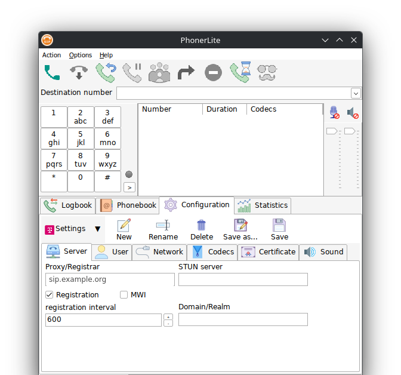

<div align="center">

[🇬🇧 English](../README.md) | [🇨🇳 简体中文](README.zh-CN.md) | **🇪🇸 Español** | [🇧🇷 Português](README.pt-BR.md) | [🇩🇪 Deutsch](README.de.md) | [🇫🇷 Français](README.fr.md) | [🇯🇵 日本語](README.ja.md) | [🇰🇷 한국어](README.ko.md) | [🇷🇺 Русский](README.ru.md) | [🇺🇦 Українська](README.uk.md)

# PhonerLite para NixOS



**Un softphone SIP gratuito, empaquetado para Nix — funciona sobre Wine con todos los problemas de integración con el escritorio ya resueltos.**

[](https://github.com/varsoug/phonerlite-flake/actions/workflows/ci.yml)
[](https://github.com/varsoug/phonerlite-flake/releases)
[](../LICENSE)
[](https://nixos.org)
[](https://www.winehq.org)

[**Inicio rápido**](#-inicio-rápido) ·
[Funciones](#-funciones) ·
[Instalación](#-instalación) ·
[Cómo funciona](#-cómo-funciona) ·
[Probado en](#-probado-en)

</div>

---

[PhonerLite](https://www.phonerlite.de) es un softphone SIP gratuito (freeware) para Windows.
Este flake lo empaqueta para NixOS / Nix en Linux y lo ejecuta mediante Wine **como debe
ejecutarse**: decoración de ventana nativa, fuentes suavizadas, DPI sensato y una ventana que
sobrevive a minimizar.

Si solo instalas `pkgs.wine` y ejecutas `wine PhonerLite.exe`, chocarás con un muro en minutos:
*«Bad EXE format»*, fuentes pixeladas, botones de ventana estilo WinXP, una ventana que nunca
vuelve tras minimizar y una app que siempre se reabre minimizada. Este paquete soluciona todo
eso desde el principio.

## 👥 ¿Para quién es esto?

- Usas **NixOS o Nix** (con flakes o sin ellos) y necesitas un softphone SIP en Linux.
- Estás en **KDE Plasma con Wayland** — justo donde `wine PhonerLite.exe` suele fallar.
- No quieres **configurar nada a mano**: sin winecfg, winetricks ni registro.
- Quieres el **build del fabricante** de PhonerLite (freeware, código cerrado), no un sustituto.

## 🚀 Inicio rápido

```bash
nix run github:varsoug/phonerlite-flake
```

La primera ejecución compila el paquete (un minuto aproximadamente) e inicia PhonerLite. Las
cuentas SIP, la agenda y el historial viven en `~/.local/share/phonerlite/` — la aplicación
sigue siendo totalmente portable. El ZIP portable del fabricante viene con el flake, así que la
compilación no necesita red.

## ✨ Funciones

|   |   |
|---|---|
| 🍷 **Wine ya ajustado** | Prefijo de 64 bits propio, controlador correcto, correcciones de registro e ini automáticas. |
| 🪟 **Decoración nativa** | KWin/GNOME dibujan la barra de título — sin botones WinXP integrados. |
| 🔤 **Fuentes nítidas** | Suavizado completo de fuentes (equivalente a ClearType) activado en el prefijo. |
| 🖼️ **DPI sensato** | Renderiza a 120 PPI por defecto para que los iconos no se vean toscos; configurable. |
| 🗂️ **Prefijo aislado** | Vive en `~/.local/share/phonerlite-prefix`; tu `~/.wine` nunca se toca. |
| 📦 **Cero configuración** | Una línea de módulo o un `nix run` — sin winecfg, winetricks ni ediciones manuales del registro. |
| 🔌 **Estado portable** | Cuentas, agenda y registros quedan en `~/.local/share/phonerlite/`, fuera del store. |

## 📦 Instalación

### Opción 1 — Módulo de NixOS (recomendado)

**1.** Añade la entrada al `flake.nix` de tu sistema:

```nix
{
  inputs = {
    nixpkgs.url = "github:NixOS/nixpkgs/nixos-unstable";
    # ...tus otras entradas...
    phonerlite.url = "github:varsoug/phonerlite-flake";
  };
```

**2.** Activa el módulo:

```nix
  outputs = { self, nixpkgs, ... }@inputs: {
    nixosConfigurations.myhost = nixpkgs.lib.nixosSystem {
      specialArgs = { inherit inputs; };
      modules = [
        # ...tus otros módulos...
        inputs.phonerlite.nixosModules.default
        { programs.phonerlite.enable = true; }
      ];
    };
  };
```

**3.** Reconstruye y lanza:

```bash
sudo nixos-rebuild switch --flake /path/to/your/flake#myhost
phonerlite
```

¿Prefieres solo el paquete? Mismo resultado:

```nix
{ environment.systemPackages = [ inputs.phonerlite.packages.x86_64-linux.phonerlite ]; }
```

### Opción 2 — Overlay

```nix
nixpkgs.overlays = [ inputs.phonerlite.overlays.default ];
# y luego, en cualquier parte de tu configuración:
environment.systemPackages = with pkgs; [ phonerlite ];
```

### Opción 3 — Sin flakes (configuración legacy)

```nix
# configuration.nix
let
  phonerlite-flake = builtins.getFlake "github:varsoug/phonerlite-flake";
in
{
  environment.systemPackages = [ phonerlite-flake.packages.x86_64-linux.phonerlite ];
}
```

> [!NOTE]
> Home-manager no es necesario — la única entrada del flake es `nixpkgs`.

## ⚙️ Configuración

La escala de la interfaz es de 120 PPI por defecto (PhonerLite está pensado para 96 PPI y si no
se ve tosco). Se cambia al invocar el paquete:

```nix
pkgs.callPackage ./packages/phonerlite.nix { scalePPI = "96"; }  # o "144"
```

## 🔍 Cómo funciona

<details>
<summary>Los detalles detrás de cada solución</summary>

**Por qué un prefijo propio.** `PhonerLite.exe` es un binario PE de 64 bits. Si tu `~/.wine` es
un prefijo de 32 bits, Wine se niega a ejecutarlo con «Bad EXE format». El lanzador mantiene su
propio prefijo en `~/.local/share/phonerlite-prefix` y nunca toca `~/.wine`.

**Por qué `wineWow64Packages.stable` y no `.wayland`.** La variante `wayland` de Wine no incluye
ningún controlador X11 (`winex11.drv` está ausente), así que la aplicación no arranca. `stable`,
`staging` y `full` incluyen ambos.

**Por qué forzar X11 (`env -u WAYLAND_DISPLAY`).** Primero, `winewayland.so` no implementa el
protocolo `xdg-decoration` — siempre dibuja su propia barra de título estilo WinXP, y la clave de
registro `Decorated=Y` solo afecta al controlador X11. Segundo, el controlador Wayland tiene un
fallo: al minimizar, los botones de la ventana dejan de funcionar hasta reiniciar. Con XWayland
ambos problemas desaparecen y el compositor dibuja una barra de título normal.

**Por qué el ZIP portable y no el instalador.** El fabricante ofrece un ZIP portable; el
instalador solo crea accesos directos. El ZIP se descomprime en el store de Nix, el lanzador lo
copia a `~/.local/share/phonerlite` en la primera ejecución y arranca desde ahí — PhonerLite
guarda `sipper.ini`, la agenda y los registros junto al `.exe`, mientras la ruta del store
permanece de solo lectura.

**Claves de registro en cada arranque** (idempotente):
- `HKCU\Control Panel\Desktop\Decorated=Y` — dejar la decoración al gestor de ventanas;
- `FontSmoothing=2`, `FontSmoothingType=2`, `FontSmoothingOrientation=1`,
  `FontSmoothingGamma=0x578` — suavizado completo de fuentes (un prefijo nuevo renderiza pixelado).
- `LogPixels` deliberadamente **no** se define: con él, PhonerLite se cuelga antes de crear su
  ventana principal.

**Correcciones ini en cada arranque** (idempotente): `WindowState=0` (si no, la app se abre
minimizada — guarda ese estado al salir) y `ScaleDefaultPPI=<scalePPI>` (escala de la interfaz).

**Detalles de empaquetado.** El desempaquetador propio de Nix no abre el ZIP del fabricante («do
not know how to unpack source archive»), por eso `dontUnpack = true` y el desempaquetado va en
`installPhase` con `unzip`; su código de salida distinto de cero por los nombres no ASCII se
ignora, y las copias de licencia por idioma se descartan. El icono se extrae de los recursos del
`.exe` con `wrestool`/`icotool`.

**CI.** `.github/workflows/ci.yml` compila el paquete y comprueba sus salidas (lanzador, archivo
desktop, icono) en cada push. El ZIP del fabricante está versionado
(`packages/PhonerLite64.zip`) porque la sandbox no puede acceder a phoner.de.

</details>

## 🖥️ Probado en

| Componente | Versión |
| --- | --- |
| SO | NixOS 26.11 «Zokor» (`nixos-unstable`) |
| DE / WM | KDE Plasma 6.8.1, KWin (sesión Wayland) |
| Wine | wine-wow64 11.0 (`wineWow64Packages.stable`) |
| PhonerLite | 3.46 (2026-10-12) |

Hardware: AMD Ryzen 7 8845HS (Radeon 780M, controlador amdgpu), x86_64, 1920x1080 @ 144 Hz.

> [!IMPORTANT]
> El paquete compila contra `wineWow64Packages.stable` porque la variante `wayland` no tiene
> controlador X11 — sin él, la aplicación no arranca. En otros entornos (GNOME, COSMIC, sway…)
> debería funcionar mediante XWayland, pero solo se ha verificado Plasma 6.8.

## ⬆️ Actualizar PhonerLite

1. Descarga el nuevo `PhonerLite64.zip` desde la
   [página de descargas del fabricante](https://www.phonerlite.de/download_en.htm).
2. Sustituye `packages/PhonerLite64.zip` por él.
3. Sube `version` en [`packages/phonerlite.nix`](../packages/phonerlite.nix).

El ZIP forma parte del repositorio porque la sandbox de CI de GitHub no tiene acceso al
fabricante.

## 📄 Licencia

El código de empaquetado de este repositorio es [MIT](../LICENSE). PhonerLite no está cubierto: es freeware propietario del fabricante (véase la [licencia del fabricante](https://www.phonerlite.de/index_en.htm)), incluido tal cual en `packages/PhonerLite64.zip` para compilar sin conexión.

<div align="center">

Si esto te ahorró una noche de winecfg — considera darle una ⭐

</div>
